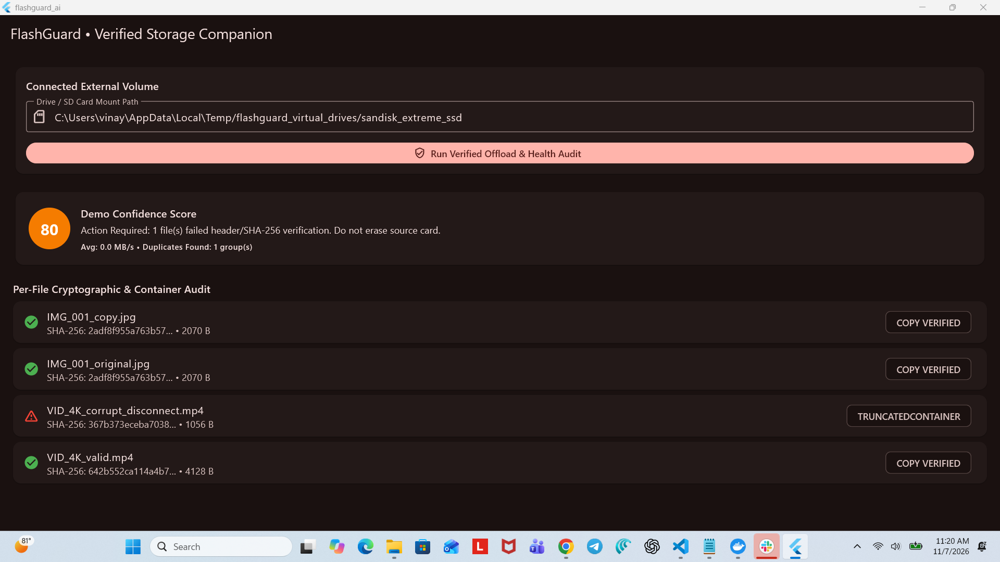
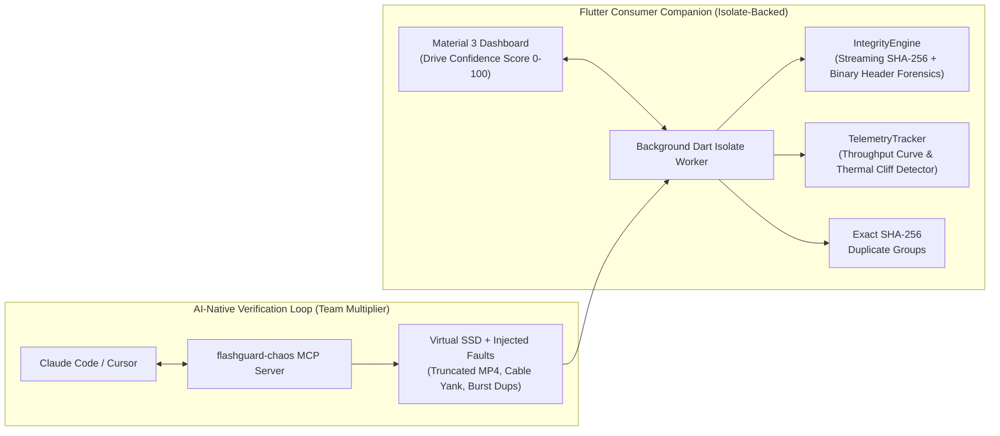

# FlashGuard AI — Hardware-Aware Consumer Storage Companion & Chaos MCP Harness

> A Flutter storage verification prototype with a Python MCP fault-injection harness.




The current demo reads a chosen directory, including the virtual-drive fixture. Native volume access remains future work. The score uses simulated free space, and throughput drops are only a thermal-throttling heuristic. A verified copy is not permission to erase the original.

## Verified Today vs. Production Roadmap

| Area | Verified today | Production roadmap |
|---|---|---|
| Storage access | Windows demo reads a chosen directory and the virtual-drive fixture. | Add native drive discovery, Android Storage Access Framework access, and Apple security-scoped file access. |
| Copy integrity | Streamed SHA-256 comparison, temporary `.part` files, refusal to overwrite an existing target, and basic JPEG/MP4 structure checks. | Add durable write guarantees, crash recovery, resumable transfers, and deeper media validation. |
| Duplicate detection | Exact byte duplicates grouped by SHA-256. | Decode images for perceptual similarity and add user-reviewed duplicate actions. |
| Telemetry | Per-file throughput samples and a demo score using simulated free-space headroom; speed drops are a heuristic. | Read real volume capacity and hardware telemetry, then calibrate and benchmark the score. |
| Verification | Two Python fixture tests, five Flutter tests, clean static analysis, and a successful Windows build and run. | Exercise Android and Apple devices, larger media fixtures, and real disconnect scenarios. |

---

## 1. Why This Exists (The Unsolved Consumer Storage Problem)
Millions of photographers, filmmakers, and everyday consumers offload irreplaceable memories onto Sandisk portable SSDs and SD cards. Yet mobile companion apps treat external storage as an infallible, passive folder tree—leaving three critical gaps:
1. **Silent Data Corruption:** Abrupt USB-C disconnects or power drops truncate MP4/MOV `moov` atoms or JPEG EOF markers without warning, leading users to delete originals from their phones before discovering unplayable files.
2. **Thermal Cliffing Blindness:** Sustained high-bitrate transfers trigger flash controller thermal throttling without actionable diagnostics or health confidence scoring in the mobile UI.
3. **Cloud-Dependent Media Triage:** Users cannot deduplicate burst shoots or audit terabytes of private local media without uploading files to paid cloud services.

---

## 2. Holistic System Architecture



---

## 3. Key Technical Highlights

* **Background batch (`Isolate.run`):** File copying, hashing, and header inspection run in a worker isolate.
* **Temporary `.part` files:** Copies are flushed, re-hashed, and renamed after byte-exact verification. Interrupted copies are removed; resumable checkpoints are not implemented.
* **Team Force-Multiplier (`mcp-server/server.py`):** A Model Context Protocol (MCP) server and custom `/verify-storage-pr` slash command that lets any Flutter engineer on the team spin up virtual drives with simulated hardware faults before opening a PR.
* **Draft review log (`docs/AI_BLUFF_LOG.md`):** Records issues found while reviewing the supplied generated code. It does not claim benchmarks or agent runs that were not performed.

---

## 4. Quick Start & Verification

### Run the Flutter Verification Suite
```bash
cd app
flutter pub get
flutter analyze --fatal-infos
flutter test test/storage_chaos_test.dart
flutter run
```

### Run the MCP Chaos Server (Claude Code / Cursor)
```bash
cd mcp-server
pip install 'mcp>=1.0,<2'
python server.py
```

---

## 5. Engineering Thesis: AI-Native Velocity Meets Storage Rigor
> *"AI coding agents have collapsed the cost of writing boilerplate Flutter widgets to near zero. That shifts the true engineering bottleneck to **specification clarity, deterministic verification harnesses, and domain empathy**. In consumer storage, where silent data loss is unacceptable, an AI-native engineer's highest leverage comes from building automated fault-injection sandboxes that verify every line of agent-generated I/O code before it ever reaches a senior engineer's review queue."*
