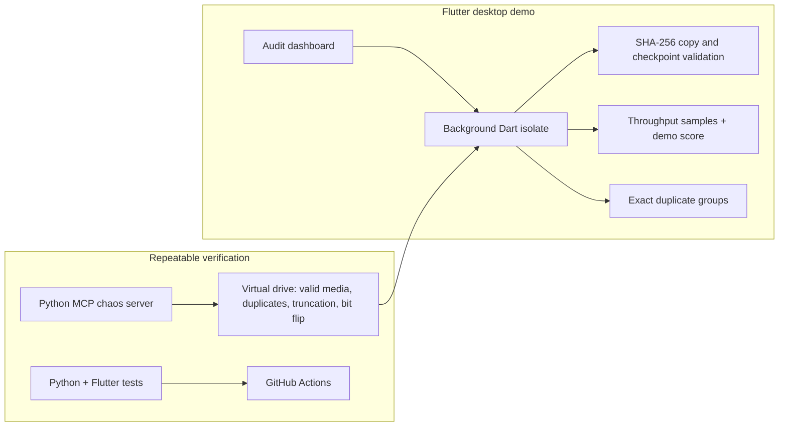

# FlashGuard AI

### Trust the copy before you retire the source.

FlashGuard turns a routine media offload into an auditable transfer: hash the source, copy into a resumable temporary file, verify the destination, and call out media that still needs human attention. The Flutter desktop demo runs the file work in a background isolate; a Python MCP server supplies repeatable storage failures for tests and AI-assisted reviews.

[](https://github.com/vinaypcv/flashguard-ai/actions/workflows/verify.yml)


## The moment this protects

A creator copies footage from a card, sees matching file sizes, and clears the card. A truncated container or a changed payload can still be missed by that size check. FlashGuard makes the copy's evidence visible before that decision. The demo flags a truncated MP4, groups byte-identical photos, and keeps the original source untouched.

| Consumer moment | What the prototype does | Why a storage team cares |
|---|---|---|
| A cable disconnects mid-copy | Retains completed `.part` blocks, validates their hashes on restart, and resumes only trusted bytes. | Recovery avoids restarting a large transfer while preserving evidence of what was copied. |
| A file looks intact by size | Checks SHA-256 and JPEG/MP4 structure; the chaos fixture flips one bit inside `mdat` without changing file size or box headers. | Tests catch a class of silent changes that size and extension checks miss. Pre-existing corruption needs a trusted original digest. |
| A user repeats an audit | Rehashes an identical vault copy with zero bytes transferred; a conflicting old copy stays intact and the new one receives a numbered name. | Repeat use is safe and does not silently replace a user's data. |
| An engineer reviews storage code | Runs deterministic Python faults and Flutter tests in CI, with an AI review command and PR checklist. | Edge cases become reproducible review evidence instead of anecdotal bug reports. |

These are engineering mechanisms, not measured claims about reduced RMAs, retention, or team velocity.

## How the proof fits together



## Run the Windows proof

Requires Python 3.11, Flutter 3.47.9, and Windows desktop support. From the repository root in PowerShell:

```powershell
cd mcp-server
py -3.11 -m venv .venv
.\.venv\Scripts\python.exe -m pip install "mcp>=1.0,<2"
.\.venv\Scripts\python.exe -c "import server; print(server.create_virtual_drive())"
cd ..\app
flutter pub get
flutter run -d windows
```

Click **Run Verified Offload & Health Audit**. The virtual drive includes a valid MP4, a truncated MP4, and two byte-identical JPEGs. Click again to re-audit. If an older fixture left a different file in the demo vault, FlashGuard keeps it and saves the current copy under a numbered name. Exit `flutter run` with `q`; relaunch it after pulling code changes.

Run the checks independently:

```powershell
cd mcp-server
.\.venv\Scripts\python.exe -m unittest discover -p 'test_*.py' -v
cd ..\app
flutter analyze --fatal-infos
flutter test --reporter expanded
```

If Flutter is installed in this checkout under `.tools/flutter`, replace `flutter` with `..\.tools\flutter\bin\flutter.bat`. The [verification record](docs/VERIFICATION.md) documents the test evidence and limits. The [PR template](.github/pull_request_template.md) and [`/verify-storage-pr`](.claude/commands/verify-storage-pr.md) make the same checks repeatable during AI-assisted development.

## Scope

This is a directory-backed Windows prototype. `ExternalVolumeProvider` separates capacity data from the audit worker, but Android SAF and iOS security-scoped volume handlers currently return an explicit pending error. The dashboard uses simulated free-space capacity and a throughput-drop heuristic, not physical drive health telemetry. No source file is deleted, and a successful copy check is not permission to erase the original.
